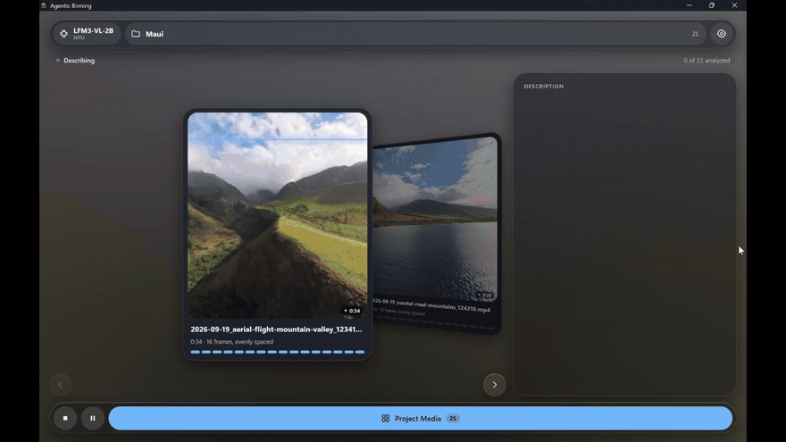
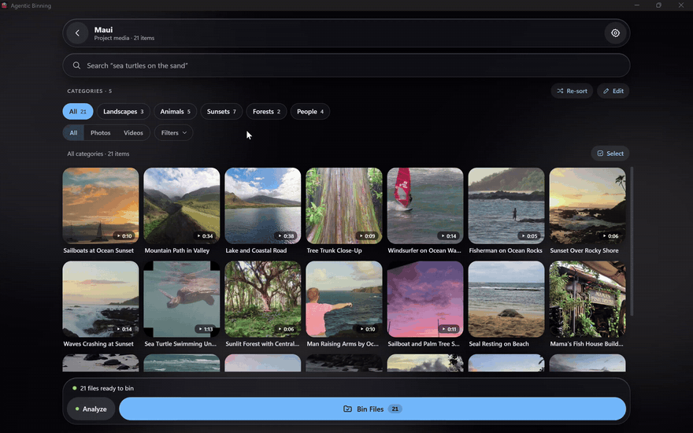

# Agentic Binning for Windows

**Your photos and videos, analyzed and sorted by a local AI vision model on a Snapdragon X PC.**

This is the Windows version of [Agentic Binning for Android](https://github.com/jdtimothy/Agentic-Binning-Android). You point it at a folder of photos and videos. A vision model running on the computer's NPU through Qualcomm's GenieX looks at every file, gives it a friendly name, a short description, tags, a category and a shot type. **Bin Files** then moves everything into category folders. You can search the project by keyword at any time. Your media never leaves the computer.

<p>
  
  
</p>

## What you need

- A PC with a **Snapdragon X Elite or X2 Elite** and Windows 11 on ARM.
- The **GenieX CLI**. If it isn't installed, Settings offers an Install button that runs `winget install Qualcomm.GenieX.CLI` once you press it (you can also run that yourself). The app finds `geniex.exe` on the PATH or in `%LOCALAPPDATA%\GenieX CLI`; if it doesn't, set the path in Settings.
- The models. The app can download them with `geniex pull`, or you can pull them yourself:
  ```powershell
  geniex pull LiquidAI/LFM3-VL-2B-GGUF:Q4_0 --model-type vlm
  geniex pull LiquidAI/LFM3-1.7B-GGUF:Q4_0 --model-type llm
  ```
- Recommended: **FFmpeg**. Settings offers to install it with `winget install BtbN.FFmpeg.LGPL` (an ARM64 build). With it, video frames are read precisely, HEIC and DNG stills work, and clips waiting in line get thumbnails. Without it, the app's own window reads frames from video formats Windows can play.

Without GenieX the app still starts and lists what you add, but analysis waits: the top-left chip reads **GenieX not installed** and a run stops with a message pointing to Settings. Nothing is installed until you press Install there, next to the license of what it installs. winget downloads each program from its publisher's own release; nothing is bundled with the app.

## How it uses GenieX

The app runs GenieX as terminal commands, as child processes, and reads what they print:

| Command | When |
| --- | --- |
| `geniex --version`, `geniex list --format json` | At start and in Settings, to see what is installed |
| `geniex pull <model>:Q4_0 --model-type vlm\|llm --model-hub hf` | To download a model |
| `geniex serve --host 127.0.0.1:<port> --compute npu --keepalive 120` | Once, when a run first needs a model. Every photo, video clip and sorting call is then sent to it on this computer, so the model stays loaded between them. It is stopped when the app closes |
| `geniex infer <model>:Q4_0 --compute npu --nctx … --max-tokens … -s <system prompt> --grammar-path <file> -i <prompt file>` | Once per photo, clip and sorting call instead, only when `geniex serve` cannot start |

The command behind the last call is written to the activity log in Settings, so you can paste it into a terminal. The details, and what was observed of GenieX to get them right, are at the top of [`crates/core/src/geniex.rs`](crates/core/src/geniex.rs) and [`crates/core/src/geniex_serve.rs`](crates/core/src/geniex_serve.rs).

## How it works

1. **Make a project.** A project is a folder under `Pictures\Agentic Binning`. Its database and thumbnails live in a hidden `.binning` folder inside it.
2. **Add a folder or pick files**, or drop them on the window. Files are only read; they stay where they are.
3. **Analysis runs.** The Analyze screen shows the model writing each description. Pause holds after the current item; Stop is remembered until you press Resume.
4. **Sorting** files every analyzed item into a category, with the local LFM3-1.7B model or, if you choose, Claude.
5. **Browse, search, filter and edit** in Project Media. Names and categories you set are locked, so a Re-sort keeps them.
6. **Bin Files** renames each file to its friendly name and moves it into its category's folder. Nothing is ever overwritten, every copy is checked by size and SHA-256 before an original is deleted, and a stopped or crashed run picks up where it left off. There is no undo.

### Optional: Claude for sorting

Sorting can use Claude instead of the local model. It works only from the text the local model wrote (names, descriptions, tags). Photos and videos are never sent. It needs your own Anthropic API key, kept in Windows Credential Manager, and each sort is a paid call. It is off until you save a key.

## Keyboard and mouse

| | |
| --- | --- |
| ← → or the mouse wheel | Move through the carousel |
| Space | Pause or resume |
| Enter | Open the item in view |
| M | Project Media |
| Ctrl+F | Search the project |
| Ctrl+click a tile, Ctrl+A | Select items |
| Esc | Close a sheet, leave selection, go back |
| Drop files or folders on the window | Add them to the open project |

## Building

You need Rust (stable) and, on Windows:

- the Visual Studio C++ build tools with the ARM64 components;
- clang, which `ring` (the app's SHA-256 and TLS) needs for its C and assembly parts on ARM64: the Visual Studio Installer's "C++ Clang tools for Windows" component, or `winget install LLVM.LLVM`.

Run cargo with the ARM64 build environment loaded: from "Developer PowerShell for VS" set to ARM64, or after running `vcvarsall.bat arm64` from the build tools' `VC\Auxiliary\Build` folder in the same command prompt. Without it the build stops at `ring` with `'assert.h' file not found`.

```powershell
git clone https://github.com/jdtimothy/Agentic-Binning-Windows.git
cd Agentic-Binning-Windows
cargo test -p binning-core          # the core's tests
npm install -g @tauri-apps/cli@2    # or: cargo install tauri-cli --locked
cd src-tauri
tauri build                         # the installer lands in target\release\bundle\nsis
```

`tauri dev` runs the app without packaging it. Every push also builds the installer on GitHub's Windows ARM64 runner; it is attached to the workflow run as an artifact.

## Privacy

- Analysis happens on this computer. Photos and videos are never uploaded.
- The app reads only the folders and files you add.
- Cloud sorting is off by default and sends only the text the local model wrote.

## License

This project's own code is under the [MIT License](LICENSE). GenieX, the QNN runtime inside it, and the LFM3 models have their own terms; see [THIRD_PARTY_NOTICES.md](THIRD_PARTY_NOTICES.md).
