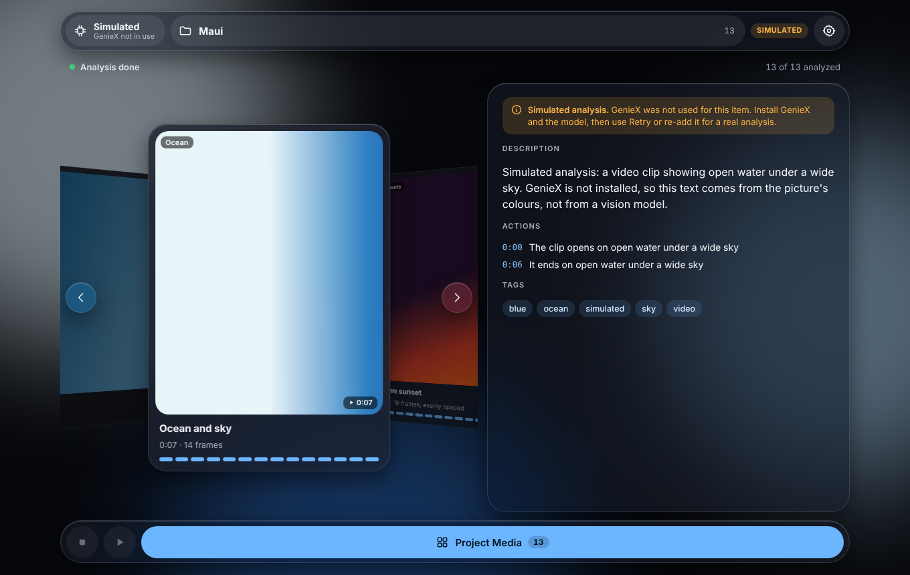
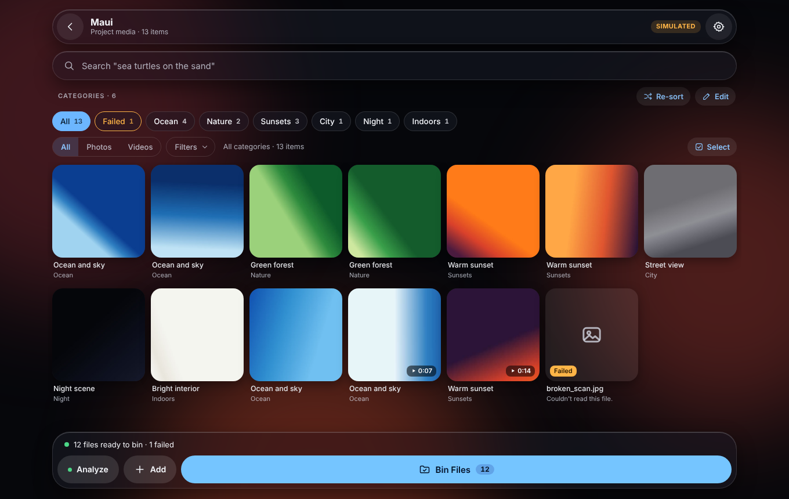

# Agentic Binning for Windows

**Your photos and videos, analyzed and sorted by a local AI vision model on a Snapdragon X PC.**

This is the Windows version of [Agentic Binning for Android](https://github.com/jdtimothy/Agentic-Binning-Android). You point it at a folder of photos and videos. A vision model running on the computer's NPU through Qualcomm's GenieX looks at every file, gives it a friendly name, a short description, tags, a category and a shot type. **Bin Files** then moves everything into category folders. You can search the project by keyword at any time. Your media never leaves the computer.

It has the same glass look, the same two screens (Analyze and Project Media), the same sheets and the same rules as the Android app, laid out for a wide window, a mouse and a keyboard.

<p>
  
  
</p>

*These screenshots were taken with the built-in simulated model on generated test pictures, not with GenieX.*

> **Status: built and tested without a Snapdragon X PC.** The core logic has about 370 automated tests, most of them the Android app's own test cases run against this code. They pass on Linux and on GitHub's Windows ARM64 machine, with a simulated model. Nothing has run on a Snapdragon X PC yet, and no real `geniex` command has been executed. The tests that need the real thing are written and wait in `crates/core/tests/on_device.rs`. Start with [docs/testing-on-windows.md](docs/testing-on-windows.md), or give an agent [docs/windows-agent-brief.md](docs/windows-agent-brief.md).

## What you need

- A PC with a **Snapdragon X Elite or X2 Elite** and Windows 11 on ARM.
- The **GenieX CLI** installed, with the Qualcomm NPU driver it asks for. The app finds `geniex.exe` on the PATH; if it doesn't, set the path in Settings.
- The models. The app can download them with `geniex pull`, or you can pull them yourself:
  ```powershell
  geniex pull LiquidAI/LFM3-VL-2B-GGUF:Q4_0 --model-type vlm
  geniex pull LiquidAI/LFM3-1.7B-GGUF:Q4_0 --model-type llm
  ```
- Optional: **FFmpeg** on the PATH (`winget install Gyan.FFmpeg`). With it, video frames are read exactly as on Android, and HEIC and DNG stills work. Without it, the app's own window reads frames from video formats Windows can play.

Without GenieX the app still starts. It uses a simulated model, labels everything it writes as simulated, and lets you try every screen, including Bin Files.

## How it uses GenieX

The app runs GenieX as terminal commands, as child processes, and reads what they print:

| Command | When |
| --- | --- |
| `geniex --version`, `geniex list --format json` | At start and in Settings, to see what is installed |
| `geniex pull <model>:Q4_0 --model-type vlm\|llm --model-hub hf` | To download a model |
| `geniex infer <model>:Q4_0 --compute npu --nctx … --max-tokens … -s <system prompt> --grammar-path <file> -i <prompt file>` | Once per photo, per video clip, and per sorting call |

The exact command line of the last call is written to the activity log in Settings, so you can paste it into a terminal. The details, and what was read from the GenieX source to get them right, are at the top of [`crates/core/src/geniex.rs`](crates/core/src/geniex.rs).

Two things differ from Android because of how the command line works:

- **The model is loaded for every item.** Each `geniex infer` is a new process, so each photo pays the model's load time. `geniex serve` would keep it loaded; that is a possible next step, not built.
- **Video timestamps are listed, not interleaved.** The CLI attaches every image ahead of the text, so the frame times are given as a list in the prompt instead of sitting next to their frames. The prompt version is recorded as `analysis-v2-cli`.

## How it works

1. **Make a project.** A project is a folder under `Pictures\Agentic Binning`. Its database and thumbnails live in a hidden `.binning` folder inside it.
2. **Add a folder or pick files**, or drop them on the window. Files are only read; they stay where they are.
3. **Analysis runs.** The Analyze screen shows the model writing each description. Pause holds after the current item; Stop is remembered until you press Resume.
4. **Sorting** files every analyzed item into a category, with the local LFM3-1.7B model or, if you choose, Claude.
5. **Browse, search, filter and edit** in Project Media. Names and categories you set are locked, so a Re-sort keeps them.
6. **Bin Files** renames each file to its friendly name and moves it into its category's folder. Nothing is ever overwritten, every copy is checked by size and SHA-256 before an original is deleted, and a stopped or crashed run picks up where it left off. There is no undo.

### Optional: Claude for sorting

Sorting can use Claude instead of the local model. It works only from the text the local model wrote (names, descriptions, tags). Photos and videos are never sent. It needs your own Anthropic API key, kept in Windows Credential Manager, and each sort is a paid call. It is off until you save a key.

## Keyboard and mouse

| | |
| --- | --- |
| ← → or the mouse wheel | Move through the carousel |
| Space | Pause or resume |
| Enter | Open the item in view |
| M | Project Media |
| Ctrl+F | Search the project |
| Ctrl+click a tile, Ctrl+A | Select items |
| Esc | Close a sheet, leave selection, go back |
| Drop files or folders on the window | Add them to the open project |

## Building

You need Rust (stable) and, on Windows, the Visual Studio C++ build tools with the ARM64 components.

```powershell
git clone https://github.com/jdtimothy/Agentic-Binning-Windows.git
cd Agentic-Binning-Windows
cargo test -p binning-core          # the core's tests
npm install -g @tauri-apps/cli@2    # or: cargo install tauri-cli --locked
cd src-tauri
tauri build                         # the installer lands in target\release\bundle\nsis
```

`tauri dev` runs the app without packaging it. Every push also builds the installer on GitHub's Windows ARM64 runner; it is attached to the workflow run as an artifact.

### Working on the interface without Windows

```bash
cargo run -p binning-devserver -- --data /tmp/ab-data --projects /tmp/ab-projects
# then open http://127.0.0.1:4173
```

This serves the same interface to a web browser with the real core behind it and the simulated model. Pickers become a prompt for a path. It listens on this computer only.

## How the code is laid out

| Path | What |
| --- | --- |
| `crates/core` | Everything that is not a window: the project database, analysis and sorting prompts and parsers, the pipeline, the file-move engine, the GenieX command runner, the Claude client, and the command interface the window calls |
| `src-tauri` | The Windows app: a Tauri window, native pickers, drag and drop, Show in Explorer |
| `ui` | The interface: plain HTML, CSS and JavaScript modules, no build step |
| `crates/devserver` | The browser mode above |

The project database uses the Android app's schema (version 5) and table names, so the two apps describe a project the same way. Paths inside a database are absolute, so a project made on a phone does not open usefully on a PC or the other way round.

## Privacy

- Analysis happens on this computer. Photos and videos are never uploaded.
- The app reads only the folders and files you add.
- Cloud sorting is off by default and sends only the text the local model wrote.

## License

This project's own code is under the [MIT License](LICENSE). GenieX, the QNN runtime inside it, and the LFM3 models have their own terms; see [THIRD_PARTY_NOTICES.md](THIRD_PARTY_NOTICES.md).
